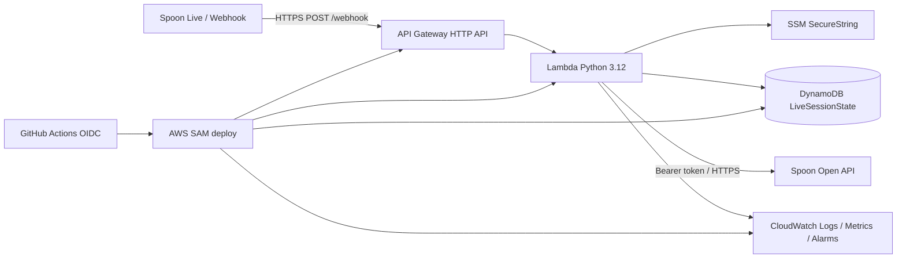
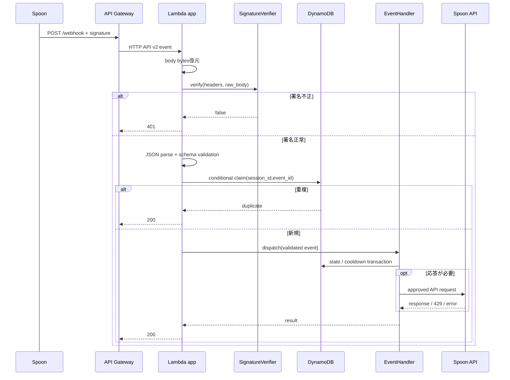

# SPOON配信マネージャーBot 基本設計

## 1. 設計目標
- 入力資料のAWSサーバーレス構成を維持する。
- 署名検証、冪等性、ロール制御、レート制御を副作用の前に実施する。
- Spoon Developers利用規約のOAuth 2.0、最小権限、データ最小化、削除、審査要件を設計へ組み込む。
- Spoon公式API仕様が未提供の箇所をアダプターと設定へ隔離し、推測で固定しない。

## 2. アーキテクチャ



添付構成図と方式設計の主要要素を採用する。ただし、図の単一「Spoon API Token」は固定共有トークンではなく、OAuth 2.0認可コードフローで取得・更新するアクセストークンとして扱う。MVPは単一HOSTに限定し、OAuthクライアント情報、アクセストークン、リフレッシュトークンをSSM Parameter Store Standard TierのSecureStringへ保存する。これによりSecrets Managerやカスタマー管理KMS鍵の固定費を追加しない。

## 3. 処理パイプライン



処理順は必ず「本文復元 → 署名検証 → JSON/スキーマ検証 → 冪等性確保 → ディスパッチ → 副作用」とする。`input/code_artifact.md` のLambda処理手順に冪等性呼出しが欠ける点は、この設計で修正する。

## 4. 論理コンポーネント

```text
src/
├── app.py                       # API Gatewayアダプター、例外→HTTP変換
├── config.py                    # 環境変数と検証済み設定
├── domain/
│   ├── models.py                # Event, Actor, Command, HandlerResult
│   ├── errors.py                # ドメイン例外
│   └── command_registry.py      # コマンド定義・ロール許可表
├── security/
│   ├── signature.py             # 生bytesの署名検証
│   └── token_provider.py        # OAuthトークン取得/更新インターフェース
├── validation/
│   └── payload.py               # 公式スキーマ境界
├── dispatcher.py
├── handlers/
│   ├── join.py
│   ├── comment.py
│   ├── gift.py
│   └── live_end.py
├── repositories/
│   └── live_state.py            # DynamoDB実装
├── clients/
│   └── spoon_api.py             # Spoon APIアダプター
└── observability/
    └── logger.py                # 構造化ログ・マスキング
```

既存詳細設計の責務を保ちながら、ドメイン、検証、セキュリティ、外部I/Oを分離する。具体的なファイル構成は実装段階で過度に細分化しないよう調整可能とする。

### 4.1 `app.py`
- HTTP API v2イベントから本文をbytesとして復元する。
- ヘッダーを大文字小文字非依存で取得する。
- 認証、検証、冪等性、ディスパッチを順序どおり調停する。
- 例外を要件のHTTP結果契約へ変換する。
- 応答には相関IDを含めてもよいが、内部詳細は含めない。

### 4.2 `SignatureVerifier`
```python
class SignatureVerifier(Protocol):
    def verify(self, headers: Mapping[str, str], raw_body: bytes) -> bool: ...
```
- HMAC-SHA256は入力設計上の候補だが、最終的にはSpoon公式Webhook仕様を正とする。
- シークレットはSSMから取得し、Lambdaウォーム環境で期限付きキャッシュ可能とする。
- キャッシュ更新またはシークレットローテーションを可能にする。

### 4.3 `PayloadValidator`
- イベント共通項目を `event_id`, `event_type`, `live_session_id`, `occurred_at` として正規化する（公式名称へのマッピングは確定後に実装）。
- 種別ごとのデータを型付きモデルへ変換する。
- 生ペイロードをログまたはDynamoDBへ丸ごと保存しない。

### 4.4 `EventDispatcher`
- イベント種別とハンドラーの辞書を保持する。
- 未知イベントは `ignored_unknown_event` として正常終了する。
- ハンドラーはHTTPやLambda固有型に依存しない。

### 4.5 `CommentHandler` / `CommandRegistry`
コマンド定義例:
```python
@dataclass(frozen=True)
class CommandDefinition:
    name: str
    allowed_roles: frozenset[Role]
    min_args: int
    max_args: int | None
    cooldown_scope: CooldownScope
    handler: CommandHandler
```

- `!` と `/` を認識し、先頭・末尾空白と連続空白を正規化する。
- ロールは `HOST > MANAGER > LISTENER` とするが、暗黙の数値比較ではなく許可集合で判定する。
- 権限不足はチャットへ出力せず、匿名化した監査イベントのみ記録する。
- 正式コマンド表は要件P0決定後、設定またはコード内レジストリとして確定する。

### 4.6 `LiveStateRepository`
```python
class LiveStateRepository(Protocol):
    def claim_event(self, session_id: str, event_id: str, expires_at: int) -> bool: ...
    def acquire_cooldown(self, scope_key: str, now: int, seconds: int) -> bool: ...
    def close_session(self, session_id: str, expires_at: int) -> None: ...
```

`claim_event` と `acquire_cooldown` はDynamoDBの条件式/トランザクションで原子的に行い、Lambdaインメモリ状態へ正しさを依存させない。

### 4.7 `SpoonApiClient`
- 接続先を許可されたベースURLに固定し、任意URLを受け取らない。
- Authorization値をログへ渡さない。
- 接続・読み取りを含む総タイムアウトを設定する。
- 429では `Retry-After` またはジッター付き指数バックオフを使う。
- Lambda contextの残り時間が安全マージンを下回る前に中止する。
- 「初回 + 最大2回再試行」を明示する。

### 4.8 OAuth 2.0認証・トークン管理
規約第8条に従い、配信照会・管理・チャット送信にはOAuth 2.0認可コードフローによるHOSTの明示的委任を必須とする。

MVP設計:
- 対象は単一HOSTとし、公開HTTP経路は `GET /oauth/callback` だけを追加する。
- OAuth開始は公開エンドポイントにせず、AWS認証済みOPERATORが `scripts/start_oauth.py` を実行する。スクリプトは推測困難なstateと、公式対応時はPKCE verifier/challengeを生成し、state、作成時刻、使用済みフラグ、verifierをDynamoDBへ短いTTL付きで保存してSpoon認可URLを表示する。
- `/oauth/callback` はstateの一致、有効期限、未使用を条件付き更新で検証し、認可コードの再利用を防止する。
- Spoon公式仕様で対応する場合はPKCEを使用する。具体的URL、パラメータ、PKCE方式、スコープは公式資料取得後に設定する。
- OAuth client secret、access token、refresh tokenはSSM Standard Tier SecureStringに別パラメータとして保存し、既定のAWS管理キー `aws/ssm` を使う。
- Lambdaは対象パラメータだけを読取り/更新できる最小権限を持つ。アクセストークンは有効期限より短くメモリキャッシュ可能だが、refresh tokenはログ・レスポンス・DynamoDBへ出さない。
- 期限前更新または認証期限切れ時に1回だけrefreshし、SSMを上書きする。同時更新はDynamoDBの短期ロックで直列化する。
- 連携解除時は公式失効APIがあれば呼び出し、全OAuthパラメータと一時stateを削除する。
- redirect URIは固定し、dev/prodで分離する。callback後は秘密をURLや画面へ表示しない。

複数HOST対応はMVP外とする。将来対応時はHOSTごとのSSMパラメータ階層とDynamoDBマッピング、または専用の暗号化トークンストアを別specで再設計する。単一パラメータへの複数利用者トークン集約は行わない。

## 5. DynamoDBデータモデル

テーブル: `LiveSessionState`
- PK: `SESSION#{live_session_id}`
- SK: エンティティ別複合キー
- 課金: On-Demand
- TTL属性: `ttl_timestamp`（epoch seconds）
- AWS管理暗号化を有効化。必要に応じてカスタマー管理KMS鍵を検討する。

| エンティティ | SK例 | 主な属性 | TTL |
|---|---|---|---|
| Session | `META` | status, started_at, ended_at, config_version | 終了後24h |
| Event claim | `EVENT#{event_id}` | event_type, claimed_at, processing_status | 受信後24h |
| Manager | `MANAGER#{encrypted_actor_id}` | enabled, configured_by | 承認した期間 |
| Cooldown | `COOLDOWN#{scope_key}` | available_at | available_at + 猶予 |
| Gift aggregate | `GIFT_SUMMARY` | 非個人別の配信内集計 | 終了後24h |
| Song request（採用時） | `SONG#{sequence}` | title, status, requester匿名ID（必要時のみ） | 終了後24h |

### 5.1 冪等性状態
イベントclaimは次の低コストな状態機械を単一DynamoDBテーブル上で実装する。
- 新規イベントを条件付きPutで `PROCESSING` としてclaimし、lease期限を設定する。
- 重要な状態更新に成功したら `SUCCEEDED` へ更新する。
- 再試行可能な内部障害では `RETRYABLE_FAILED` とし、次回配送が条件付きで再claimできるようにする。
- `PROCESSING` のleaseが期限切れの場合だけ回復処理を許可する。
- Spoon APIへのチャット送信はbest-effortとし、重要な状態更新後に行う。送信失敗だけを理由に状態更新を巻き戻さない。

これによりSQS/outboxを追加せず、一時障害から回復しながら副作用の重複を抑える。DynamoDBの書込み回数は増えるが、低トラフィックのMVPでは追加の常時課金サービスより運用・コスト効率が高い。

### 5.2 TTL注意事項
DynamoDB TTLは期限直後の物理削除を保証しない。全読み取りで `ttl_timestamp > now` を条件とし、契約終了・削除要求向けにQuery + BatchWrite/Deleteによる明示削除手順を用意する。

## 6. エラー設計

| エラー | HTTP | ログ | 再実行 |
|---|---:|---|---|
| SignatureInvalid | 401 | WARN（理由詳細・本文なし） | Spoon仕様依存 |
| PayloadInvalid | 400 | WARN（フィールド名のみ） | 修正なしでは不可 |
| DuplicateEvent | 200 | INFO | 不要 |
| UnknownEvent | 200 | WARN/INFO | 不要 |
| CooldownActive | 200 | INFO | 不要 |
| SpoonRateLimited | 200 | ERROR + metric | 内部で限定再試行 |
| SpoonTimeout/5xx | 200 | ERROR + standard metric/log | 実行時間内で限定再試行後に終了 |
| UnexpectedError | 500 | ERROR + stack trace（マスク済み） | 状態機械により安全に再試行 |

Spoon APIへのチャット送信はMVPでは同期・best-effortとし、限定再試行後も失敗した場合はWebhookへ200を返す。曲キューやセッション状態など重要な更新はAPI送信前にDynamoDBへ保存する。Lambda内部の予期しない障害は500とし、`RETRYABLE_FAILED` またはlease期限によって再処理する。

## 7. セキュリティ設計
- Lambda実行ロールは対象テーブル、対象SSMパラメータ、ログ出力のみに制限する。
- GitHub Actionsは環境・リポジトリ・ブランチ条件付きOIDC trust policyを用いる。
- 秘密情報はSAMパラメータやGitHubログへ平文展開しない。
- ログはallowlist方式で構築し、入力payloadの辞書展開を禁止する。
- 依存関係を固定し、CIで静的解析・依存脆弱性・秘密検知を行う。
- API GatewayのTLSセキュリティポリシーとTLS 1.3対応可否はAWS実仕様で検証する。未検証のTLS 1.3保証はしない。
- IPアドレス/User-Agentは必要性と保有期間を定義できる場合だけ記録する。詳細設計の「署名失敗時IP記録」を無条件には採用しない。

## 8. 可観測性

### 8.1 ログ項目（allowlist）
`timestamp`, `level`, `request_id`, `event_type`, `event_id_hash`, `session_id_hash`, `handler`, `result`, `duration_ms`, `retry_count`, `error_code`

禁止項目: raw body、コメント全文、ニックネーム、暗号化識別子の生値、Authorization、各種secret/token。

### 8.2 メトリクス
- `WebhookReceived`, `SignatureRejected`, `PayloadRejected`
- `DuplicateEvent`, `EventHandled`, `HandlerFailed`
- `CommandAllowed`, `CommandDenied`, `CooldownSuppressed`
- `SpoonApiLatency`, `SpoonApi429`, `SpoonApiFailed`
- Lambda標準のErrors、Duration、Throttles、ConcurrentExecutions

### 8.3 アラーム
- 5xx率、Lambda Errors/Throttles
- 署名失敗急増
- Spoon API 429/失敗急増
- DynamoDB system errors/throttles
- コスト予算閾値

閾値と通知先は運用設計で確定する。

## 9. インフラ設計
- API Gateway HTTP API: `POST /webhook`、`GET /oauth/callback`、Payload Format 2.0。REST APIより低コストなHTTP APIを使用し、OAuth開始用の公開経路は設けない。
- Lambda: Python 3.12、arm64、256MB、10秒を初期設定。Webhook/OAuthを同一デプロイパッケージで処理し、常時稼働リソースを置かない。
- DynamoDB: 単一テーブル、On-Demand、複合主キー、TTL。低トラフィックMVPではPITRを無効とし、活動情報の短期保持を優先する。
- SSM Parameter Store Standard Tier: Webhook secret、OAuth client secret、access token、refresh token。SecureString + AWS管理キー `aws/ssm` を使用する。
- CloudWatch Logs: 7日保持を初期値とし、入力payloadと秘密情報を保存しない。高コストな詳細アクセスログは必要性を確認して限定する。
- 監視: AWS標準メトリクスと無料枠内のアラームを優先し、有料カスタムメトリクスはMVPで作らない。必要な業務指標は構造化ログから調査する。
- ネットワーク: NAT Gateway、VPC、固定IPはMVPで使用しない。LambdaはAWS標準の外向き通信を使用する。
- 不採用: Secrets Manager、SQS、SNS、Step Functions、ECS/EC2、RDS、ElastiCache、カスタマー管理KMS鍵。公式仕様または負荷が必要性を示した場合のみ再検討する。
- SAM Outputs: webhook URL、OAuth callback URL等の非秘密値のみ。
- dev/prodをスタック名とパラメータパスで分離し、未承認段階ではdevのみ許可する。

月額 `$0.00` は利用量と無料枠に依存するため保証しないが、固定費を発生させない構成とし、AWS Budgetsの通知および月次利用量確認を行う。

## 10. CI/CD設計
1. pull request: lint、型検査、単体テスト、SAM validate、秘密検知、依存スキャン。
2. main反映後: build/package、devへOIDCデプロイ、スモークテスト。
3. prod: Spoon運用承認と手動承認ゲート後にデプロイ。
4. 主要機能・スコープ・保有期間変更時: Spoon再審査チェックを必須化。
5. ロールバック: 直前SAMバージョン/Aliasへ戻し、必要ならAPI呼び出しを即時停止する。

## 11. テスト戦略
ユーザーの明示がないため本段階ではテストコードを作成しないが、実装タスクでは以下を必須とする。

### 単体
- 正常/不正/欠落署名、ヘッダー大小文字、base64本文。
- JSON・種別スキーマ検証。
- コマンド解析、引数、全ロール組合せ。
- バックオフ、Retry-After、ジッター、残り時間打切り。
- ログ禁止値が出力されないこと。

### AWS統合
- DynamoDB並行claimで1件のみ成功。
- クールダウンの原子的取得。
- TTL付与と期限切れ論理除外。
- SSM/KMS/IAMの最小権限。
- API Gateway HTTP API v2イベント契約。

### 契約/E2E
- Spoon公式サンプルWebhookとの契約テスト。
- OAuth認可・更新・失効。
- Open API 200/400/401/403/429/5xx/timeout。
- dev環境でWebhook受信からチャット応答まで。

## 12. 設計判断記録

| ID | 判断 | 状態 |
|---|---|---|
| ADR-001 | AWS API Gateway HTTP API + Lambda + DynamoDB + SSM + SAMを採用 | Accepted（入力資料） |
| ADR-002 | グローバルな冪等性・クールダウンを単一DynamoDBテーブルで実現 | Accepted |
| ADR-003 | OAuth 2.0認可コードフローを必須とし、MVPは単一HOSTのトークンをSSM Standard SecureStringへ保存 | Accepted |
| ADR-004 | 冪等性は `PROCESSING/SUCCEEDED/RETRYABLE_FAILED` + leaseの状態機械とする | Accepted |
| ADR-005 | Open API送信は同期・best-effortとし、SQS/outboxはMVPで使用しない | Accepted |
| ADR-006 | 正式コマンド名・引数・文面はSpoon詳細仕様とユーザー決定後に確定 | Deferred |
| ADR-007 | MVPは単一HOST。複数HOST対応は別specで再設計 | Accepted |
| ADR-008 | 固定費のあるNAT Gateway、Secrets Manager、カスタマー管理KMS鍵、常時稼働基盤を使用しない | Accepted |

## 13. 要件対応表

| 設計領域 | 対応要件 |
|---|---|
| API Gateway / app | R1, R3, R4 |
| SignatureVerifier / SSM | R2, R10 |
| PayloadValidator / Dispatcher | R3, R4 |
| CommandRegistry / handlers | R5, R6 |
| OAuth / SpoonApiClient | R7, R8 |
| DynamoDB | R3, R8, R9 |
| Observability | R10 |
| SAM / CI/CD | R11 |
| 運用・表示 | R12 |
