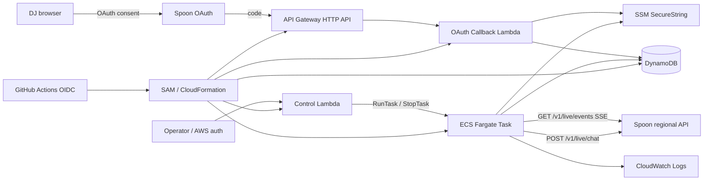
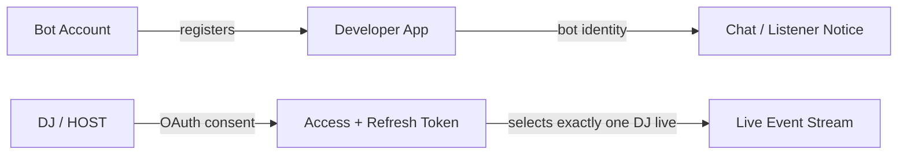
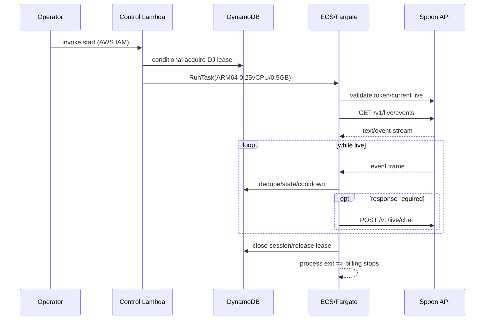

# SPOON配信マネージャーBot 基本設計

## 1. 改訂理由

Spoon Developers公式仕様ではライブイベントはWebhookではなく、Botが `GET /v1/live/events` に確立するServer-Sent Events（SSE）で配信される。API Gateway + 10秒Lambdaの受動Webhook構成を撤回し、OAuth callback/control planeはサーバーレス、長時間SSE処理は配信中だけ起動するECS Fargate Taskへ分離する。

## 2. 全体構成



### 2.1 責務分離
- **OAuth Callback Lambda**: code/state検証、token交換、SSM保存。短時間処理。
- **Control Lambda**: AWS IAM認証済みOPERATORから起動/停止を受け、排他leaseとECS RunTask/StopTaskを制御する。公開HTTP APIは不要。
- **Fargate Worker**: SSE接続を維持し、イベント処理とchat API送信を行う。
- **DynamoDB**: 起動lease、OAuth state、イベント重複、クールダウン、短期配信状態。
- **SSM**: OAuth client secret、access/refresh token、地域設定等の秘密。

## 3. アカウント・認可モデル



- Bot AccountとDJ Accountは別アカウントとする。
- 1 token = 1 DJとし、MVPでは1組だけ保持する。
- Botのチャット表示名とlistener notice表示名はBot Accountに由来する。
- DJをpath/queryで指定せず、Tokenが対象ライブを決定する。
- 権限はDeveloper App登録済みかつDJが同意した共通部分だけ有効となる。

## 4. 起動・停止フロー



- ECS Serviceは作成せず、`RunTask` で単発Taskを起動する。
- 配信終了を正式イベントまたはcurrent live APIで確認して終了する。単なるSSE切断では終了しない。
- 起動失敗や異常終了時にleaseが残らないよう期限を持たせ、Workerが定期更新する。
- 初期MVPはAWS CLI等のIAM認証済み操作で開始/停止する。公開管理画面は作らない。

## 5. SSE Worker設計

### 5.1 コンポーネント

```text
src/
├── oauth_callback.py
├── control.py
├── worker.py
├── config.py
├── spoon/
│   ├── region.py
│   ├── oauth.py
│   ├── sse_client.py
│   ├── sse_parser.py
│   └── chat_client.py
├── domain/
│   ├── events.py
│   ├── commands.py
│   ├── roles.py
│   └── errors.py
├── handlers/
│   ├── chat.py
│   ├── join.py
│   ├── heart.py
│   └── donation.py
├── repositories/
│   └── live_state.py
└── observability/
    └── logger.py
scripts/
└── start_oauth.py
```

### 5.2 `SseClient`
```python
class SseClient(Protocol):
    def events(self, token: str, resume_id: str | None = None) -> Iterator[SseMessage]: ...
```

- `Accept: text/event-stream` とBearer Tokenを使用する。
- allowlist済み地域別base URL以外へ接続しない。
- redirectは原則拒否し、Tokenを別hostへ転送しない。
- 接続タイムアウトを持ち、read timeoutは公式heartbeat間隔より長く設定する。
- HTTP statusを先に分岐する。SSEエラー本文も `data:` で始まり得るため、無条件にJSONとして解析しない。
- 401は単一refresh、403は停止、429はRetry-After、5xx/切断は上限付きbackoffとする。

### 5.3 `SseParser`
- chunk境界と行境界が一致しない前提でbufferする。
- CRLF/LF、複数`data:`行、`event:`、`id:`、`retry:`、コメント行、空行dispatchを処理する。
- 1イベントの最大bytesを設定し、超過時は接続を安全に閉じる。
- JSON化後に公式種別ごとの型付きschemaへ変換する。
- 未知fieldは前方互換性のため許容し、未知event typeは副作用なしで無視する。

### 5.4 再接続
```text
CONNECTED -> TRANSIENT_FAILURE -> BACKING_OFF -> CONNECTING
CONNECTED -> AUTH_EXPIRED -> REFRESH_ONCE -> CONNECTING
CONNECTED -> PERMISSION_OR_REGION_ERROR -> STOPPED
CONNECTED -> LIVE_ENDED / OPERATOR_STOP -> STOPPED
```

- 公式の`retry:`/Retry-Afterを優先する。
- それ以外はfull jitter付き指数backoff、上限と連続失敗回数を設定する。
- event ID/resume仕様が提供される場合だけcheckpointを使う。
- 再接続がlistener noticeを再投稿する可能性があるため、不要な定期再接続を行わない。

## 6. イベント処理

| 公式カテゴリ | 内部型 | 処理 |
|---|---|---|
| chat | ChatEvent | 自己投稿除外、コマンド解析、RBAC |
| join | JoinEvent | 頻度制限付きwelcome |
| heart | HeartEvent | 承認済み集計/応答 |
| donation | DonationEvent | お礼と配信内集計 |
| 5番目の公式event | Pending | 公式schema確認後に追加 |

旧 `live.end` は削除する。SSE切断をlive endとして扱わない。Bot自身のchatおよびlistener noticeがstreamへ返るかを契約テストし、公式actor識別子で除外する。

## 7. OAuth設計

- `scripts/start_oauth.py` がstateと、対応時はPKCEを生成し、DynamoDBへ短期TTL付きで保存して認可URLを表示する。
- 公開経路は `GET /oauth/callback` のみ。
- callback Lambdaはstateを条件付きで一回利用にし、codeをtokenへ交換する。
- TokenはSSM Standard SecureStringへ分離保存する。
- Fargate Workerが期限前または401時に一度だけrefreshする。同時refreshはDynamoDB lockで直列化する。
- revoke/解除時はTaskを先に停止し、公式revoke後にSSM tokenとstateを削除する。

## 8. 地域解決・通信保護

```python
@dataclass(frozen=True)
class SpoonRegionConfig:
    app_region: str
    dj_region: str
    api_base_url: str
    oauth_base_url: str
    allowed_hosts: frozenset[str]
```

- AWS region `ap-northeast-1` とSpoon regionは別設定とする。
- app/Bot/DJの地域制約を起動時に検証する。
- base URLは公式表から選択し、ユーザー入力URLを直接使用しない。
- inbound不要のFargate Taskをpublic subnetへ配置し、Security Group inboundを空にする。
- NAT Gateway/ALBを置かない。Task実行中のpublic IPv4従量料金は許容する。

## 9. DynamoDBモデル

テーブル: `LiveSessionState`、On-Demand、TTL `ttl_timestamp`。

| PK | SK | 用途 | TTL |
|---|---|---|---|
| `DJ#SINGLE` | `LEASE` | Task ID、lease期限、heartbeat | 短期 |
| `OAUTH#SINGLE` | `STATE#{hash}` | state、PKCE verifier、used | 数分 |
| `SESSION#{session}` | `META` | status、Task ID、開始/終了 | 終了後24h |
| `SESSION#{session}` | `EVENT#{event_id}` | 重複抑止 | 24h |
| `SESSION#{session}` | `COOLDOWN#{scope}` | 次回送信可能時刻 | 短期 |
| `SESSION#{session}` | `CHECKPOINT` | 公式resume ID | 24h |
| `SESSION#{session}` | `SUMMARY` | 非個人別集計 | 24h |

- 公式event IDがない場合、推測hashを恒久的な冪等キーにしない。
- TTLは即時削除を保証しないため、期限切れを論理的に除外する。
- 契約終了時は明示Query/Deleteを実行する。

## 10. Chat API設計

- `POST /v1/live/chat` をSSEと同じDJ Token・region resolverで呼び出す。
- request schema、長さ、rate limitは公式spec確定後に型へ固定する。
- DynamoDBでコマンドscopeごとの5秒cooldownを原子的に取得する。
- Bot自己投稿をSSE側で除外し、応答ループを防ぐ。
- 429はRetry-Afterを優先し、POSTの再試行安全性が確認できる場合のみ限定再試行する。
- chat送信はbest-effort。曲キュー等の重要状態を先に保存する。

## 11. エラー設計

| 条件 | Worker動作 |
|---|---|
| OAuth callback invalid state | 400、token交換なし |
| token exchange/refresh失敗 | 秘密を隠して失敗、Worker停止 |
| SSE 401 | refresh一度、失敗なら停止 |
| SSE 403 | permission/region errorで停止 |
| SSE 429 | Retry-After、上限付き再接続 |
| SSE 5xx/切断 | jitter backoffで再接続 |
| SSE malformed/oversize | 当該event破棄または接続再確立 |
| 未知event | 記録して無視 |
| Chat 429/5xx/timeout | best-effort失敗、SSE継続 |
| DynamoDB回復不能障害 | 副作用を止めTask終了 |

## 12. 可観測性

許可ログ項目: `timestamp`, `level`, `task_id`, `session_hash`, `dj_hash`, `connection_state`, `event_type`, `event_id_hash`, `result`, `duration_ms`, `reconnect_count`, `error_code`。

禁止: Authorization、token/secret、SSE raw data、chat全文、nickname、listener ID生値、OAuth code/state生値。

監視:
- ECS Task stopped reason / exit code
- lease heartbeat遅延
- SSE connected/disconnected、連続再接続回数、最終event時刻
- OAuth refresh失敗、401/403/429
- Chat API失敗
- DynamoDB throttles/errors
- Task稼働時間とAWS予算

有料カスタムメトリクスを増やさず、ECS/CloudWatch標準メトリクスと構造化ログを優先する。

## 13. IaC・CI/CD

### AWS
- API Gateway HTTP API: OAuth callbackのみ。
- Lambda: OAuth callback、control。短時間・arm64。
- ECS Cluster: cluster自体の常時コンピュートなし。
- Fargate Task Definition: Linux/ARM64、0.25 vCPU、0.5GB、desired serviceなし。
- VPC: public subnet、Internet Gateway、inboundなし。NAT/ALBなし。
- DynamoDB: On-Demand + TTL。
- SSM: Standard SecureString + `aws/ssm`。
- CloudWatch Logs: 7日保持。

### コンテナ
- 公開ソース用の公開container registryを使用し、Task Definitionでdigest固定する。
- imageにcredentialを含めない。
- root filesystem read-only、non-root user、不要Linux capabilityなし。

### GitHub Actions
- PR: lint、type、pytest、SSE parser fuzz/property test、SAM validate、container scan、secret scan。
- main: arm64 image build/push、dev IaC deploy。
- prod: Spoon承認と手動gate後にdeploy。自動でFargate Taskを起動しない。

## 14. コスト設計

旧「実質0円のLambdaのみ」はSSE長時間接続と両立しないため撤回する。最小コストで正しく動かすため、Fargate Taskを配信中だけ実行する。

- ECS Service 0、停止中Task 0でアイドルcompute課金を避ける。
- Fargate On-Demandを使用し、配信中断リスクのあるSpotはMVP本番で使わない。
- NAT Gateway、ALB、ECR private storage、Secrets Manager、RDSを避ける。
- 課金対象は主にFargate vCPU/memory、Task用public IPv4、ログ、少量のAPI Gateway/Lambda/DynamoDBとなる。
- 実装前に東京regionの最新単価と想定配信時間で見積り、AWS Budgetsを設定する。

## 15. テスト戦略

### 単体
- SSE chunk/line境界、複数data、heartbeat、id/retry、malformed、oversize。
- 401 refresh、403停止、429 Retry-After、5xx/切断backoff。
- event schema、未知event、自己投稿除外。
- command/RBAC/cooldown。
- region allowlistとredirect拒否。
- ログ禁止値の非出力。

### 統合
- OAuth state一回利用、token保存/refresh/revoke。
- ECS RunTask排他lease、heartbeat期限、StopTask。
- DynamoDB event dedupe/checkpoint/TTL。
- mock SSE serverとの長時間接続・切断・resume。

### 公式契約/E2E
- 公式5event payload。
- 1 token = 1 DJ、権限別に流れるevent。
- Bot Account名義chatとlistener notice。
- Bot投稿のSSE echo有無。
- live開始/終了、再接続、region不一致。

## 16. 設計判断記録

| ID | 判断 | 状態 |
|---|---|---|
| ADR-001 | Webhook/API Gateway受信を撤回し、`GET /v1/live/events` SSEを使用 | Accepted |
| ADR-002 | OAuth 2.0、単一DJ・単一token MVP | Accepted |
| ADR-003 | DJとは別のBot Accountでapp登録 | Accepted |
| ADR-004 | SSE Workerは配信中のみFargate On-Demand Taskで実行 | Accepted |
| ADR-005 | ECS Service/NAT/ALB/Fargate SpotをMVPで使わない | Accepted |
| ADR-006 | OAuth callback/controlはLambda、状態はDynamoDB、秘密はSSM Standard | Accepted |
| ADR-007 | `POST /v1/live/chat` は同期best-effort | Accepted |
| ADR-008 | 正式event schema、権限名、resume/rate limit | Pending official spec |
| ADR-009 | 正式command catalog | Deferred to user specification |

## 17. 参照資料
- [Spoon Developer Docs](https://developers.spooncast.net/docs/en)
- [Build a bot](https://developers.spooncast.net/docs/en/getting-started/build-a-bot)
- [Register an app](https://developers.spooncast.net/docs/en/getting-started/app-registration)
- [Get a DJ's consent](https://developers.spooncast.net/docs/en/getting-started/user-authorization)
- [Choose permissions](https://developers.spooncast.net/docs/en/getting-started/choosing-permissions)
- [Live events (SSE)](https://developers.spooncast.net/docs/en/api-reference/live-events)
- [Chat API](https://developers.spooncast.net/docs/en/api-reference/chat)
- [Token API](https://developers.spooncast.net/docs/en/api-reference/tokens)
- [Endpoint overview](https://developers.spooncast.net/docs/en/api-reference/endpoints)
- [AWS Lambda timeout](https://docs.aws.amazon.com/lambda/latest/dg/configuration-timeout.html)
- [AWS Fargate pricing](https://aws.amazon.com/fargate/pricing/)
- [SSM Parameter Store tiers](https://docs.aws.amazon.com/systems-manager/latest/userguide/parameter-store-advanced-parameters.html)

> 参照サイトの内容はライセンス遵守のため引用せず、設計判断として要約・再構成した。
