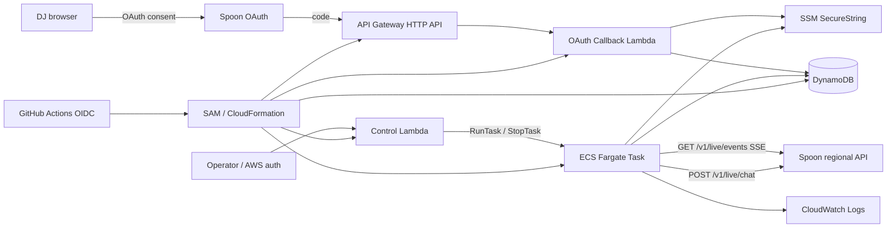
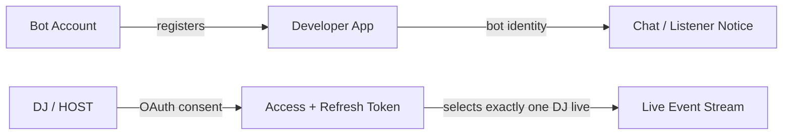
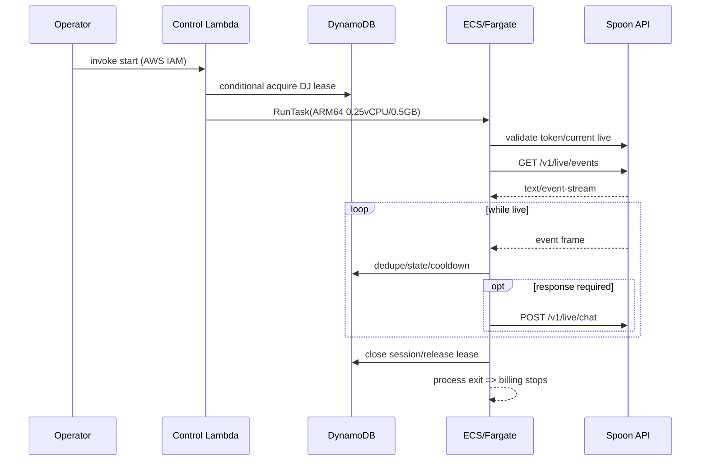

# SPOON配信マネージャーBot 基本設計

## 1. 改訂理由

Spoon Developers公式仕様ではライブイベントはWebhookではなく、Botが `GET /v1/live/events` に確立するServer-Sent Events（SSE）で配信される。API Gateway + 10秒Lambdaの受動Webhook構成を撤回し、OAuth callback/control planeはサーバーレス、長時間SSE処理は配信中だけ起動するECS Fargate Taskへ分離する。

## 2. 全体構成



### 2.1 責務分離
- **OAuth Callback Lambda**: code/state検証、token交換、SSM保存。短時間処理。
- **Control Lambda**: AWS IAM認証済みOPERATORから起動/停止を受け、排他leaseとECS RunTask/StopTaskを制御する。公開HTTP APIは不要。
- **Fargate Worker**: SSE接続を維持し、イベント処理とchat API送信を行う。
- **DynamoDB**: 起動lease、OAuth state、イベント重複、クールダウン、短期配信状態。
- **SSM**: OAuth client secret、access/refresh token、地域設定等の秘密。

## 3. アカウント・認可モデル



- Bot AccountとDJ Accountは別アカウントとする。
- 1 token = 1 DJとし、MVPでは1組だけ保持する。
- Botのチャット表示名とlistener notice表示名はBot Accountに由来する。
- DJをpath/queryで指定せず、Tokenが対象ライブを決定する。
- 権限はDeveloper App登録済みかつDJが同意した共通部分だけ有効となる。

## 4. 起動・停止フロー



- ECS Serviceは作成せず、`RunTask` で単発Taskを起動する。
- 配信終了を正式イベントまたはcurrent live APIで確認して終了する。単なるSSE切断では終了しない。
- 起動失敗や異常終了時にleaseが残らないよう期限を持たせ、Workerが定期更新する。
- 初期MVPはAWS CLI等のIAM認証済み操作で開始/停止する。公開管理画面は作らない。

## 5. SSE Worker設計

### 5.1 コンポーネント

```text
src/
├── oauth_callback.py
├── control.py
├── worker.py
├── config.py
├── spoon/
│   ├── region.py
│   ├── oauth.py
│   ├── sse_client.py
│   ├── sse_parser.py
│   └── chat_client.py
├── domain/
│   ├── events.py
│   ├── commands.py
│   ├── roles.py
│   └── errors.py
├── handlers/
│   ├── chat.py
│   ├── join.py
│   ├── heart.py
│   └── donation.py
├── repositories/
│   └── live_state.py
└── observability/
    └── logger.py
scripts/
└── start_oauth.py
```

外部仕様の詳細は [`docs/spoon-api-contract.md`](../../../docs/spoon-api-contract.md) を正とする。

### 5.2 `SseClient`
```python
class SseClient(Protocol):
    def events(self, token: str) -> Iterator[SseMessage]: ...
```

- `Authorization: Bearer` と `Accept: text/event-stream` だけを送る。path/queryなし。
- allowlist済み地域別base URL（MVPは `jp-openapi.spooncast.net`）以外へ接続しない。
- redirectは拒否し、Tokenを別hostへ転送しない。
- connect timeout 10秒、read timeoutは45秒（heartbeat 15秒の3倍）。超過したら切断とみなす。
- HTTP statusで先に分岐する。エラーbodyもSSE形式のため、`data:` を外してから `detailCode` を読む。
- 再開（`Last-Event-ID`）は送らない（公式未提供）。

### 5.3 `SseParser`
- chunk境界と行境界が一致しない前提でbufferする。
- CRLF/LF、複数`data:`行、`event:`、`id:`、`retry:`、`:` comment（heartbeat）、空行dispatchを処理する。`data:` のないフレームはdispatchしない。
- 1イベントの最大bytes（既定64KiB）を設定し、超過時は接続を閉じて再接続する。
- JSON化後に公式5種別の型付きモデルへ変換する。未知fieldは無視し、未知event typeは副作用なしで無視する。

### 5.4 接続ループ（`end.reason` 駆動）
```text
CONNECTING
  ├─ 200 → STREAMING
  ├─ 404 OAPI_MNGR_0301 → WAITING_FOR_LIVE（5〜30秒jitter、待機上限で STOPPED）
  ├─ 401 → REFRESH_ONCE → CONNECTING（refresh後も401なら STOPPED: REAUTH_REQUIRED）
  ├─ 403 detailCodeなし → STOPPED: CONSENT_REQUIRED
  ├─ 403 OAPI_MNGR_0209 → STOPPED: BLOCKED_BY_DJ
  ├─ 429（body空） → BACKING_OFF（Retry-Afterがあれば優先）
  └─ 500 / 502 / ネットワーク失敗 → BACKING_OFF（1→2→4…最大30秒 + full jitter）
STREAMING
  ├─ end LIVE_ENDED → STOPPED: LIVE_ENDED
  ├─ end TOKEN_EXPIRED → REFRESH_ONCE → CONNECTING（待たない）
  ├─ end RECONNECT → CONNECTING（待たない）
  ├─ end DUPLICATE_CONNECTION → STOPPED: DUPLICATE
  └─ endなし切断 / read timeout → BACKING_OFF
```

- 配信中かを `GET /v1/live` で事前確認しない（往復が増え、確認と接続の間に終わる可能性があるため）。
- `TOKEN_EXPIRED` は1時間ごとに必ず発生する正常系。事前refreshしても開いているストリームは失効時刻に閉じるため、`end` を契機にrefreshする。
- 再接続しても入場メッセージは再表示されない。不要な定期再接続は行わない。
- 連続失敗回数の上限（既定20回）を超えたら STOPPED にして通知する。

## 6. イベント処理

| event | 内部型 | 処理 |
|---|---|---|
| `chat` | ChatEvent | コマンド解析、RBAC（`isDj` でHOST判定） |
| `presence` | PresenceEvent | 任意のウェルカム（同一配信で `user.id` 単位に一度） |
| `like` | LikeEvent | `totalAmount` で集計、`PAID` に応答 |
| `donation` | DonationEvent | `amount`（合計スプーン）で集計、お礼 |
| `end` | StreamEndEvent | 接続ループへ `reason` を返す |

- Bot自身の発言はストリームに戻らないため、自己発言の除外処理は持たない。同じ配信の他Botとの応答ループを防ぐため、無視するユーザーIDを設定できる。
- 発言者の識別は `user.id` のみ。`nickname` はnullがあり得るため表示時に「匿名」等へ置換する。
- ストリームの再開が未提供のため、イベント単位の重複抑止テーブルとcheckpointは持たない。`presence` の再入場だけはメモリ内の `user.id` 集合で除く（Task再起動時のリセットは許容）。

### 6.1 ロール判定
- HOST: `chat.isDj == true`。
- MANAGER: HOSTが管理コマンドで登録した `user.id`。DynamoDBに保存し、HOSTの解除または連携解除で削除する。`chat` には発言者のマネージャー情報がないため、Spoonアプリ上のマネージャー指定とは連動させない。
- LISTENER: それ以外、および判定できない場合。

### 6.2 入場ウェルカム（任意機能）
- 既定は無効。有効化には `events.presence` と `dj.follow` の追加同意、DJによるBotの固定マネージャー指定が必要。同意は積み重なるため、追加分だけで同意画面を再表示する。
- 運用手順: 追加同意 → 配信中にWorkerが一度だけ `POST /v1/live/follow` を呼ぶ（またはBotアカウントでアプリから直接フォロー）→ 配信後にDJがBotを固定マネージャーに指定 → 次回配信から有効。
- Botがマネージャーでなくてもエラーにはならず、`presence` が届かないだけなので、届かない状態を監視ログで検知できるようにする。

## 7. OAuth設計

- `scripts/start_oauth.py` がstateと、対応時はPKCEを生成し、DynamoDBへ短期TTL付きで保存して認可URLを表示する。
- 公開経路は `GET /oauth/callback` のみ。
- callback Lambdaはstateを条件付きで一回利用にし、受信後60秒以内にcodeを `POST /v1/oauth/token`（`grant_type=authorization_code`）でtokenへ交換する。
- OAuth endpointはBasic認証（Client ID/Secret）+ `application/x-www-form-urlencoded`。エラーはRFC 6749の `error` で分岐する（`invalid_grant` は再連携、`invalid_client` は設定不備）。
- TokenはSSM Standard SecureStringへ分離保存する。access tokenは1時間で失効する。
- token発行・更新のたびに付与scopeを保存し、Workerは有効な機能をscopeに合わせる（`chat.send` がなければ応答停止、`events.presence` がなければウェルカム無効）。
- 要求scopeは機能設定から組み立てる。MVPは `events.chat chat.send`。機能を追加するときは追加分だけで同意画面を再表示する。
- Fargate Workerは `end.reason=TOKEN_EXPIRED` または401で一度だけrefresh（`grant_type=refresh_token`）する。同時refreshはDynamoDB lockで直列化する。refresh tokenがローテーションされる場合に備え、レスポンスに含まれていれば常に上書き保存する。
- revoke/解除時はTaskを先に停止し、`POST /v1/oauth/revoke` 後にSSM token、state、MANAGER登録を削除する。

## 8. 地域解決・通信保護

```python
@dataclass(frozen=True)
class SpoonRegionConfig:
    app_region: str
    dj_region: str
    api_base_url: str
    oauth_base_url: str
    allowed_hosts: frozenset[str]
```

- AWS region `ap-northeast-1` とSpoon regionは別設定とする。
- app/Bot/DJの地域制約を起動時に検証する。
- base URLは公式表から選択し、ユーザー入力URLを直接使用しない。
- inbound不要のFargate Taskをpublic subnetへ配置し、Security Group inboundを空にする。
- NAT Gateway/ALBを置かない。Task実行中のpublic IPv4従量料金は許容する。

## 9. DynamoDBモデル

テーブル: `LiveSessionState`、On-Demand、TTL `ttl_timestamp`。

| PK | SK | 用途 | TTL |
|---|---|---|---|
| `DJ#SINGLE` | `LEASE` | Task ID、lease期限、heartbeat | 短期 |
| `OAUTH#SINGLE` | `STATE#{hash}` | state、PKCE verifier、used | 数分 |
| `DJ#SINGLE` | `MANAGER#{user_id_hash}` | HOSTが登録したMANAGERの `user.id` | なし（解除・連携解除で削除） |
| `DJ#SINGLE` | `CHAT_SUSPEND` | 1日上限の429で止めたチャット送信の再開時刻 | 再開時刻 |
| `SESSION#{session}` | `META` | status、Task ID、開始/終了、終了reason | 終了後24h |
| `SESSION#{session}` | `COOLDOWN#{scope}` | 次回送信可能時刻 | 短期 |
| `SESSION#{session}` | `SUMMARY` | 非個人別集計（ハート総数・スプーン総数） | 24h |

- ストリームの再開が未提供のため、イベント重複抑止とcheckpointの項目は持たない（公式が再開を提供したら追加する）。
- MANAGERの `user.id` は照合に必要なため値そのものを保存するが、ログには出さない。
- TTLは即時削除を保証しないため、期限切れを論理的に除外する。
- 契約終了時は明示Query/Deleteを実行する。

## 10. Chat API設計

- `POST /v1/live/chat` をSSEと同じDJ Token・region resolverで呼び出す。request項目名は公式spec確認後に型へ固定する。
- 送信前に空・空白のみを拒否し、絵文字等の非BMP文字を2文字と数える保守的な長さ（UTF-16コード単位相当）で200文字以内に収める。
- 送信は単一の送信キュー（Worker内）を通し、以下の順で速度を制御する。
  1. コマンドscopeごとの5秒cooldown（DynamoDB）
  2. 直近レスポンスの `x-ratelimit-remaining` が0なら `x-ratelimit-replenish-rate` から次の送信可能時刻を計算して待つ
  3. `CHAT_SUSPEND` 中は送信しない
- 429の扱い: `OAPI_MNGR_0302` は1〜5秒待って最大2回再送（配信全体の混雑でも発生するため上限を設ける）。detailCodeなし・`Retry-After` なしは指数バックオフ。`Retry-After` ありは1日上限として `CHAT_SUSPEND` に再開時刻を保存し、その間は送信を止める（SSE受信は継続）。
- 403 `OAPI_MNGR_0208` は30秒後に1回再試行し、続く場合はその配信中の送信を止めて記録する。
- 400 `0103` / `0108` / `0109` は再送しない（実装または入力の不備として記録）。
- chat送信はbest-effort。重要状態を先に保存し、エラーの `message` をチャットへ出さない。
- 再送の安全性（同じ内容が二重投稿されないか）は未確認のため、5xx/timeout時の再送は最大1回に限る。

## 11. エラー設計

`detailCode` で分岐し、`message` は分岐にも表示にも使わない。ゲートウェイ由来の401/403/429は `detailCode` がないため、ステータスで先に分岐する。

| 条件 | Worker動作 |
|---|---|
| OAuth callback invalid state | 400、token交換なし |
| token endpoint `invalid_grant` | 再連携が必要としてWorker停止 |
| token endpoint `invalid_client` | 設定不備としてWorker停止・通知 |
| 401（なし / `0203`） | refresh一度、それでも401なら停止（無限再試行しない） |
| 403 detailCodeなし | 権限不足。停止して再同意を要求（連携は有効なまま） |
| 403 `0208` | チャット送信だけ一時停止（§10） |
| 403 `0209` / `0211` | 停止し、DJにブロック解除を案内 |
| 404 `0301` | 配信待ち（§5.4） |
| 429 | §10（チャット）/ §5.4（ストリーム） |
| 500 `1002` / 502 `2302`・`2303` | 指数バックオフで再試行 |
| SSE malformed/oversize | 当該frame破棄、繰り返す場合は再接続 |
| 未知event / 未知field | 無視 |
| DynamoDB回復不能障害 | 副作用を止めTask終了 |

## 12. 可観測性

許可ログ項目: `timestamp`, `level`, `task_id`, `session_hash`, `dj_hash`, `connection_state`, `event_type`, `event_id_hash`, `result`, `duration_ms`, `reconnect_count`, `error_code`。

禁止: Authorization、token/secret、SSE raw data、chat全文、nickname、listener ID生値、OAuth code/state生値。

監視:
- ECS Task stopped reason / exit code
- lease heartbeat遅延
- SSE connected/disconnected、連続再接続回数、最終event時刻
- OAuth refresh失敗、401/403/429
- Chat API失敗
- DynamoDB throttles/errors
- Task稼働時間とAWS予算

有料カスタムメトリクスを増やさず、ECS/CloudWatch標準メトリクスと構造化ログを優先する。

## 13. IaC・CI/CD

### AWS
- API Gateway HTTP API: OAuth callbackのみ。
- Lambda: OAuth callback、control。短時間・arm64。
- ECS Cluster: cluster自体の常時コンピュートなし。
- Fargate Task Definition: Linux/ARM64、0.25 vCPU、0.5GB、desired serviceなし。
- VPC: public subnet、Internet Gateway、inboundなし。NAT/ALBなし。
- DynamoDB: On-Demand + TTL。
- SSM: Standard SecureString + `aws/ssm`。
- CloudWatch Logs: 7日保持。

### コンテナ
- 公開ソース用の公開container registryを使用し、Task Definitionでdigest固定する。
- imageにcredentialを含めない。
- root filesystem read-only、non-root user、不要Linux capabilityなし。

### GitHub Actions
- PR: lint、type、pytest、SSE parser fuzz/property test、SAM validate、container scan、secret scan。
- main: arm64 image build/push、dev IaC deploy。
- prod: Spoon承認と手動gate後にdeploy。自動でFargate Taskを起動しない。

## 14. コスト設計

旧「実質0円のLambdaのみ」はSSE長時間接続と両立しないため撤回する。最小コストで正しく動かすため、Fargate Taskを配信中だけ実行する。

- ECS Service 0、停止中Task 0でアイドルcompute課金を避ける。
- Fargate On-Demandを使用し、配信中断リスクのあるSpotはMVP本番で使わない。
- NAT Gateway、ALB、ECR private storage、Secrets Manager、RDSを避ける。
- 課金対象は主にFargate vCPU/memory、Task用public IPv4、ログ、少量のAPI Gateway/Lambda/DynamoDBとなる。
- 実装前に東京regionの最新単価と想定配信時間で見積り、AWS Budgetsを設定する。
- 現行概算はTask + public IPv4で `$0.0173225/時間`。標準80時間/月ではTask費 `$1.39`、周辺費と10%余裕を含む予算目安 `$1.80/月` とする。
- 詳細な前提、時間別試算、上限策は [`docs/fargate-cost-estimate.md`](../../../docs/fargate-cost-estimate.md) を正とする。

## 15. テスト戦略

### 単体
- SSE chunk/line境界、CRLF/LF、`:heartbeat`、`data:` なしframe、id/retry、malformed、oversize。
- `docs/spoon-api-contract.md` の公式サンプルによる5イベントのparse、nullable項目、未知field・未知event、JSON風message。
- `end.reason` 4種＋endなし切断の遷移、404待機上限、401 refresh-once、403のdetailCode有無による分岐、500/502 backoff。
- エラーbodyの `data:` 除去、body空の429、RFC 6749エラー。
- chat本文の長さ判定（非BMP文字）、空文字拒否、上限ヘッダーによる速度制御、`0302`/`Retry-After`/`0208` の扱い。
- command/RBAC（`isDj`、MANAGER登録）/cooldown、like集計（`totalAmount`）とdonation集計の単位。
- region allowlistとredirect拒否、ログ禁止値の非出力。

### 統合
- OAuth state一回利用、60秒以内のcode交換、token保存/refresh（ローテーション有無の両方）/revoke。
- ECS RunTask排他lease、heartbeat期限、StopTask。
- DynamoDB MANAGER登録・削除、CHAT_SUSPEND、TTL。
- mock SSE serverでの長時間接続、1時間ごとのTOKEN_EXPIRED、RECONNECT、DUPLICATE_CONNECTION、read timeout。

### 公式契約/E2E（dev配信）
- `events.chat` + `chat.send` でのコマンド応答。
- Bot名義chatとlistener notice、再接続で入場メッセージが再表示されないこと。
- Botをマネージャー指定したときだけpresenceが届くこと。
- 実レスポンスの `x-ratelimit-*` 値の記録。

## 16. 設計判断記録

| ID | 判断 | 状態 |
|---|---|---|
| ADR-001 | Webhook/API Gateway受信を撤回し、`GET /v1/live/events` SSEを使用 | Accepted |
| ADR-002 | OAuth 2.0、単一DJ・単一token MVP | Accepted |
| ADR-003 | DJとは別のBot Accountでapp登録 | Accepted |
| ADR-004 | SSE Workerは配信中のみFargate On-Demand Taskで実行 | Accepted |
| ADR-005 | ECS Service/NAT/ALB/Fargate SpotをMVPで使わない | Accepted |
| ADR-006 | OAuth callback/controlはLambda、状態はDynamoDB、秘密はSSM Standard | Accepted |
| ADR-007 | `POST /v1/live/chat` は同期best-effort | Accepted |
| ADR-008 | event schema・エラー・rate limitは `docs/spoon-api-contract.md` に従う。再開は未提供のためcheckpoint/重複抑止テーブルを持たない | Accepted |
| ADR-009 | 正式command catalog | Deferred to user specification |
| ADR-010 | MANAGERはHOSTがBotの管理コマンドで登録する（Spoonのマネージャー指定とは連動しない） | Proposed |
| ADR-011 | 入場ウェルカムは既定無効の任意機能（Botのマネージャー指定が必要） | Proposed |
| ADR-012 | 起動時に配信中でない場合、既定10分待ってTaskを終了する | Proposed |

## 17. 参照資料
- [`docs/spoon-api-contract.md`](../../../docs/spoon-api-contract.md)（外部仕様の要約、確度付き）
- [イベントストリーム（日本語）](https://developers.spooncast.net/docs/ja/api-reference/live-events)
- [エラーコード（日本語）](https://developers.spooncast.net/docs/ja/api-reference/error-codes)
- [Spoon Developer Docs](https://developers.spooncast.net/docs/en)
- [Build a bot](https://developers.spooncast.net/docs/en/getting-started/build-a-bot)
- [Register an app](https://developers.spooncast.net/docs/en/getting-started/app-registration)
- [Get a DJ's consent](https://developers.spooncast.net/docs/en/getting-started/user-authorization)
- [Choose permissions](https://developers.spooncast.net/docs/en/getting-started/choosing-permissions)
- [Live events (SSE)](https://developers.spooncast.net/docs/en/api-reference/live-events)
- [Chat API](https://developers.spooncast.net/docs/en/api-reference/chat)
- [Token API](https://developers.spooncast.net/docs/en/api-reference/tokens)
- [Endpoint overview](https://developers.spooncast.net/docs/en/api-reference/endpoints)
- [AWS Lambda timeout](https://docs.aws.amazon.com/lambda/latest/dg/configuration-timeout.html)
- [AWS Fargate pricing](https://aws.amazon.com/fargate/pricing/)
- [SSM Parameter Store tiers](https://docs.aws.amazon.com/systems-manager/latest/userguide/parameter-store-advanced-parameters.html)

> 参照サイトの内容はライセンス遵守のため引用せず、設計判断として要約・再構成した。
